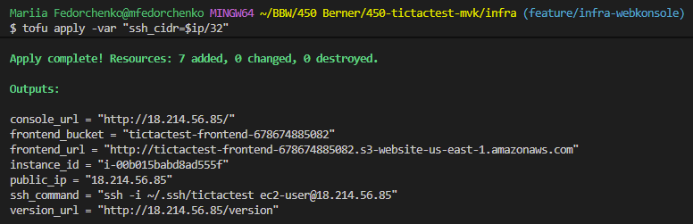

# Deployment

TicTacTest läuft in AWS (Learner Lab, `us-east-1`). OpenTofu (`infra/`) stellt bereit, **wohin und wie**
deployt wird. **Welche Version** läuft, entscheidet das Deployment. Ein neuer Release braucht weder
`tofu apply` noch eine neue Instanz.

```text
Browser ──> S3 Static Website (index.html, app.js, style.css, version.txt, config.js*)
   │            * config.js schreibt OpenTofu, mit der festen Adresse der Instanz
   └── iframe / fetch ──> Elastic IP :80 ── nginx ──┬── /         ──> ttyd (nur lo:7681) ──> java -jar tictactoe-X.Y.Z.jar
                                                    └── /version  ──> /opt/tictactest/version.txt
```

## Was OpenTofu bereitstellt

| Datei | Inhalt |
| --- | --- |
| `main.tf` | EC2-Instanz (Amazon Linux 2023), Security Group, Key Pair, Elastic IP, `LabInstanceProfile` |
| `frontend.tf` | S3-Bucket als Static Website, öffentlicher Lesezugriff, `config.js` |
| `templates/user_data.sh.tftpl` | Einrichtung beim ersten Start: Corretto 25, nginx, ttyd (feste Version + Prüfsumme), Benutzer `tictactest`, systemd-Unit, nginx-Konfiguration |
| `variables.tf`, `outputs.tf` | Variablen und Outputs für Benutzer und Pipeline |

### Offene Ports

| Port | Quelle | Grund |
| --- | --- | --- |
| 80 | `0.0.0.0/0` | nginx: Webkonsole und Versionsabfrage. Spielende kommen von überall. |
| 22 | nur `ssh_cidr` (eigene IP) | Fehlersuche per SSH. Deployt wird über SSM, dafür braucht es keinen offenen Port. |
| 7681 | — | ttyd lauscht nur auf `lo`. Nur nginx erreicht es. |

### Wie das JAR auf die Instanz kommt

Die Instanz lädt das JAR **direkt vom GitHub-Release** und prüft die SHA-256-Prüfsumme
(`/usr/local/bin/tictactest-fetch`, läuft als `ExecStartPre` vor jedem Start).

- Das Repository ist öffentlich, es braucht also keine Zugangsdaten. Bei einem privaten Repository müsste ein
  Token auf die Instanz, dann wäre ein privater S3-Bucket mit Zugriff über das Instance Profile besser.
- Die Version steht in `/etc/tictactest.env` (`VERSION=1.3.0`). Die Datei liegt auf der Platte der Instanz und
  überlebt einen Neustart. Darum startet nach einem Neustart dieselbe Version.
- Versionswechsel = `/etc/tictactest.env` ändern und den Dienst neu starten. Das JAR wird beim Start geladen,
  falls es noch fehlt. Keine neue Instanz, kein `tofu apply`.
- Die Version steht bewusst **nicht** in `user_data`. Sonst würde jeder Release `user_data` ändern, und wegen
  `user_data_replace_on_change = true` würde OpenTofu die Instanz neu erstellen.

### Was im öffentlichen Bucket nie landen darf

Alles im Frontend-Bucket kann jede Person lesen. Deshalb nie: `*.tfstate`, `*.tfvars`, Schlüssel, AWS-Zugangsdaten,
`.env`-Dateien. Nur die statischen Dateien aus dem Release und `config.js` (enthält nur öffentliche URLs).

### Outputs

| Output | Verwendung | Vertraulich? |
| --- | --- | --- |
| `frontend_url` | Hier spielt man | nein |
| `console_url`, `version_url` | Webkonsole, Versionsprüfung nach dem Deployment | nein |
| `instance_id` | Ziel für `aws ssm send-command` | nein (ohne Zugangsdaten nutzlos) |
| `frontend_bucket` | Ziel für `aws s3 sync` | nein |
| `public_ip`, `ssh_command` | Fehlersuche | nein |

Vertraulich sind die AWS-Zugangsdaten und der private SSH-Schlüssel. Sie sind kein Output und nie im Repository.

## Infrastruktur aufbauen

Voraussetzung: Learner Lab gestartet, unter **AWS Details → AWS CLI** die Zugangsdaten nach
`~/.aws/credentials` kopiert (laufen mit der Session ab).

```sh
cd infra
tofu init
tofu validate
ip=$(curl -s https://checkip.amazonaws.com)
tofu plan  -var "ssh_cidr=$ip/32"
tofu apply -var "ssh_cidr=$ip/32"
tofu output
```

Die Einrichtung (`user_data`) dauert nach dem `apply` noch 1–2 Minuten. Kontrolle per SSH:
`sudo cloud-init status --wait`, Log in `/var/log/cloud-init-output.log`.


## Deployment von Hand

```sh
cd infra
INSTANCE=$(tofu output -raw instance_id)
BUCKET=$(tofu output -raw frontend_bucket)
VERSION_URL=$(tofu output -raw version_url)
V=1.3.0
```

**Backend** (über SSM, ohne SSH):

```sh
aws ssm send-command --instance-ids "$INSTANCE" --document-name AWS-RunShellScript \
  --parameters "commands=[\"echo VERSION=$V > /etc/tictactest.env\",\"systemctl restart tictactest\"]" \
  --query Command.CommandId --output text
curl -s "$VERSION_URL"          # muss $V zeigen
```

Alternative per SSH: `ssh ec2-user@<ip> "echo VERSION=$V | sudo tee /etc/tictactest.env && sudo systemctl restart tictactest"`

**Frontend** (aus dem Release-ZIP, `config.js` von OpenTofu bleibt):

```sh
rm -rf /tmp/frontend && mkdir /tmp/frontend && cd /tmp/frontend
curl -fsSLO "https://github.com/okurshike/450-tictactest-mvk/releases/download/v$V/tictactest-frontend-$V.zip"
unzip -q "tictactest-frontend-$V.zip" && rm "tictactest-frontend-$V.zip"
aws s3 sync . "s3://$BUCKET" --delete --exclude config.js
curl -s "http://$BUCKET.s3-website-us-east-1.amazonaws.com/version.txt"   # muss $V zeigen
```

`--delete` entfernt Dateien, die es im neuen Release nicht mehr gibt. `--exclude config.js` schützt die Datei von
OpenTofu: Ausgeschlossene Dateien werden weder hochgeladen noch gelöscht.

### SSM oder SSH für GitHub Actions?

| | SSM (`aws ssm send-command`) | SSH |
| --- | --- | --- |
| Zugangsdaten in GitHub | nur AWS-Zugangsdaten, die es für S3 sowieso braucht | zusätzlich ein privater SSH-Schlüssel |
| Offener Port | keiner | 22 müsste für GitHub-Runner offen sein (wechselnde IPs) |
| Voraussetzung | SSM-Agent (in Amazon Linux enthalten) + Instance Profile mit SSM-Rechten | nichts weiter |
| Nachteil | Befehl läuft asynchron, Ergebnis muss man abfragen | Port 22 weltweit offen = Angriffsfläche |

## Nachweis: zwei Releases von Hand

| Schritt | Ergebnis |
| --- | --- |
| `tofu apply` |  |
| Release A (`v1.3.0`) deployt | TODO: Screenshot Frontend mit Backend 1.3.0 / Frontend 1.3.0 |
| Release B (`v1.4.0`, sichtbare Änderung im Frontend) deployt | TODO: Screenshot |
| `tofu plan` nach Release B | TODO: muss „No changes“ zeigen |

## Robustheit (Experimente)

| Experiment | Erwartung | Ergebnis |
| --- | --- | --- |
| Learner-Lab-Session beenden, neue starten | Instanz startet neu, Elastic IP bleibt, systemd startet ttyd mit der Version aus `/etc/tictactest.env` | TODO |
| Einrichtung ändern (z. B. neue `Environment=` in der Unit) | `tofu plan` zeigt `aws_instance` **must be replaced** (wegen `user_data_replace_on_change`). Elastic IP bleibt, neue Instanz hat keine `/etc/tictactest.env`: Version muss neu deployt werden | TODO |
| `tofu destroy` + `tofu apply` | Neue Elastic IP, neue Instanz-ID. Der Bucket-Name bleibt (enthält die Account-ID). Danach Backend und Frontend neu deployen (Auftrag 3: dieselben Werte in GitHub anpassen) | TODO |
