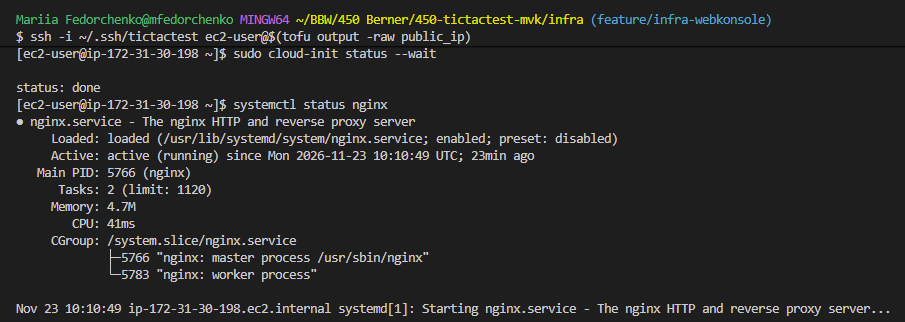
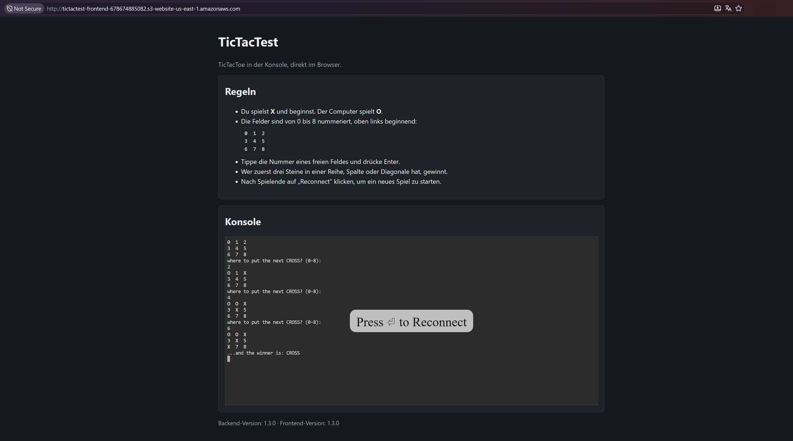
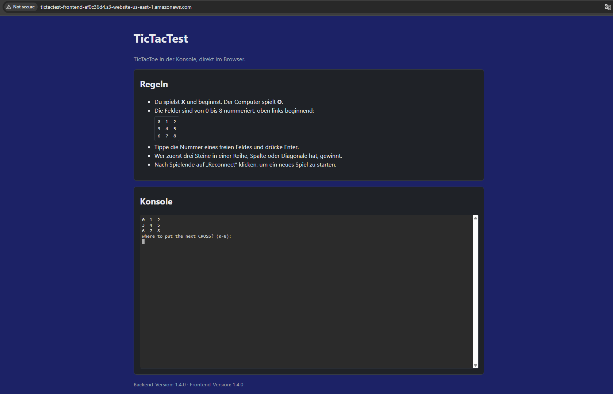
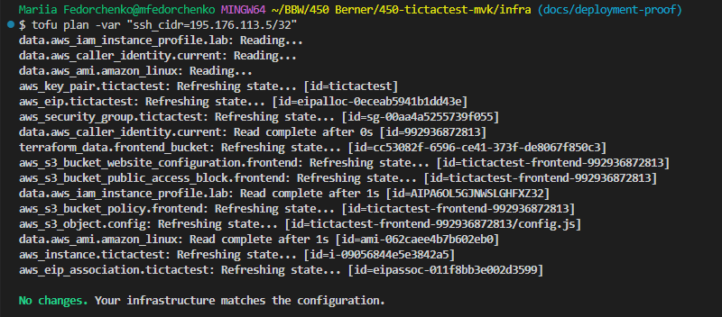
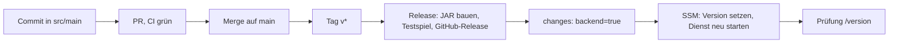
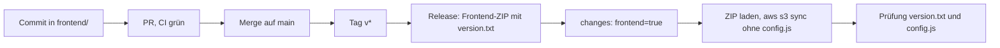

# Deployment

TicTacTest läuft in AWS (Learner Lab, `us-east-1`). OpenTofu (`infra/`) stellt bereit, **wohin und wie**
deployt wird. **Welche Version** läuft, entscheidet das Deployment. Ein neuer Release braucht weder
`tofu apply` noch eine neue Instanz.

```text
Browser ──> S3 Static Website (index.html, app.js, style.css, version.txt, config.js*)
   │            * config.js schreibt OpenTofu, mit der festen Adresse der Instanz
   └── iframe / fetch ──> Elastic IP :80 ── nginx ──┬── /         ──> ttyd (nur lo:7681) ──> java -jar tictactoe-X.Y.Z.jar
                                                    └── /version  ──> /opt/tictactest/version.txt
```

## Was OpenTofu bereitstellt

| Datei | Inhalt |
| --- | --- |
| `main.tf` | EC2-Instanz (Amazon Linux 2023), Security Group, Key Pair, Elastic IP, `LabInstanceProfile` |
| `frontend.tf` | S3-Bucket als Static Website, öffentlicher Lesezugriff, `config.js` |
| `templates/user_data.sh.tftpl` | Einrichtung beim ersten Start: Corretto 25, nginx, ttyd (feste Version + Prüfsumme), Benutzer `tictactest`, systemd-Unit, nginx-Konfiguration |
| `variables.tf`, `outputs.tf` | Variablen und Outputs für Benutzer und Pipeline |

### Offene Ports

| Port | Quelle | Grund |
| --- | --- | --- |
| 80 | `0.0.0.0/0` | nginx: Webkonsole und Versionsabfrage. Spielende kommen von überall. |
| 22 | nur `ssh_cidr` (eigene IP) | Fehlersuche per SSH. Deployt wird über SSM, dafür braucht es keinen offenen Port. |
| 7681 | — | ttyd lauscht nur auf `lo`. Nur nginx erreicht es. |

### Wie das JAR auf die Instanz kommt

Die Instanz lädt das JAR **direkt vom GitHub-Release** und prüft die SHA-256-Prüfsumme
(`/usr/local/bin/tictactest-fetch`, läuft als `ExecStartPre` vor jedem Start).

- Das Repository ist öffentlich, es braucht also keine Zugangsdaten. Bei einem privaten Repository müsste ein
  Token auf die Instanz, dann wäre ein privater S3-Bucket mit Zugriff über das Instance Profile besser.
- Die Version steht in `/etc/tictactest.env` (`VERSION=1.3.0`). Die Datei liegt auf der Platte der Instanz und
  überlebt einen Neustart. Darum startet nach einem Neustart dieselbe Version.
- Versionswechsel = `/etc/tictactest.env` ändern und den Dienst neu starten. Das JAR wird beim Start geladen,
  falls es noch fehlt. Keine neue Instanz, kein `tofu apply`.
- Die Version steht bewusst **nicht** in `user_data`. Sonst würde jeder Release `user_data` ändern, und wegen
  `user_data_replace_on_change = true` würde OpenTofu die Instanz neu erstellen.

### Was im öffentlichen Bucket nie landen darf

Alles im Frontend-Bucket kann jede Person lesen. Deshalb nie: `*.tfstate`, `*.tfvars`, Schlüssel, AWS-Zugangsdaten,
`.env`-Dateien. Nur die statischen Dateien aus dem Release und `config.js` (enthält nur öffentliche URLs).

### Outputs

| Output | Verwendung | Vertraulich? |
| --- | --- | --- |
| `frontend_url` | Hier spielt man | nein |
| `console_url`, `version_url` | Webkonsole, Versionsprüfung nach dem Deployment | nein |
| `instance_id` | Ziel für `aws ssm send-command` | nein (ohne Zugangsdaten nutzlos) |
| `frontend_bucket` | Ziel für `aws s3 sync` | nein |
| `public_ip`, `ssh_command` | Fehlersuche | nein |

Vertraulich sind die AWS-Zugangsdaten und der private SSH-Schlüssel. Sie sind kein Output und nie im Repository.

## Infrastruktur aufbauen

Voraussetzung: Learner Lab gestartet, unter **AWS Details → AWS CLI** die Zugangsdaten nach
`~/.aws/credentials` kopiert (laufen mit der Session ab).

```sh
cd infra
tofu init
tofu validate
ip=$(curl -s https://checkip.amazonaws.com)
tofu plan  -var "ssh_cidr=$ip/32"
tofu apply -var "ssh_cidr=$ip/32"
tofu output
```

Die Einrichtung (`user_data`) dauert nach dem `apply` noch 1–2 Minuten. Kontrolle per SSH:
`sudo cloud-init status --wait`, Log in `/var/log/cloud-init-output.log`.



## Deployment von Hand

```sh
cd infra
INSTANCE=$(tofu output -raw instance_id)
BUCKET=$(tofu output -raw frontend_bucket)
VERSION_URL=$(tofu output -raw version_url)
V=1.3.0
```

**Backend** (über SSM, ohne SSH):

```sh
aws ssm send-command --instance-ids "$INSTANCE" --document-name AWS-RunShellScript \
  --parameters "commands=[\"echo VERSION=$V > /etc/tictactest.env\",\"systemctl restart tictactest\"]" \
  --query Command.CommandId --output text
curl -s "$VERSION_URL"          # muss $V zeigen
```

Alternative per SSH: `ssh ec2-user@<ip> "echo VERSION=$V | sudo tee /etc/tictactest.env && sudo systemctl restart tictactest"`

**Frontend** (aus dem Release-ZIP, `config.js` von OpenTofu bleibt):

```sh
rm -rf /tmp/frontend && mkdir /tmp/frontend && cd /tmp/frontend
curl -fsSLO "https://github.com/okurshike/450-tictactest-mvk/releases/download/v$V/tictactest-frontend-$V.zip"
unzip -q "tictactest-frontend-$V.zip" && rm "tictactest-frontend-$V.zip"
aws s3 sync . "s3://$BUCKET" --delete --exclude config.js
curl -s "http://$BUCKET.s3-website-us-east-1.amazonaws.com/version.txt"   # muss $V zeigen
```

`--delete` entfernt Dateien, die es im neuen Release nicht mehr gibt. `--exclude config.js` schützt die Datei von
OpenTofu: Ausgeschlossene Dateien werden weder hochgeladen noch gelöscht.

### SSM oder SSH für GitHub Actions?

| | SSM (`aws ssm send-command`) | SSH |
| --- | --- | --- |
| Zugangsdaten in GitHub | nur AWS-Zugangsdaten, die es für S3 sowieso braucht | zusätzlich ein privater SSH-Schlüssel |
| Offener Port | keiner | 22 müsste für GitHub-Runner offen sein (wechselnde IPs) |
| Voraussetzung | SSM-Agent (in Amazon Linux enthalten) + Instance Profile mit SSM-Rechten | nichts weiter |
| Nachteil | Befehl läuft asynchron, Ergebnis muss man abfragen | Port 22 weltweit offen = Angriffsfläche |

## Nachweis: zwei Releases von Hand

| Schritt | Ergebnis |
| --- | --- |
| `tofu apply` |  |
| Release A (`v1.3.0`) deployt |  |
| Release B (`v1.4.0`, sichtbare Änderung im Frontend) deployt |  |
| `tofu plan` nach Release B |  Das Deployment ändert nur Inhalte (Version auf der Instanz, Dateien im Bucket), nicht die Infrastruktur. |

## Robustheit (Experimente)

| Experiment | Erwartung | Ergebnis |
| --- | --- | --- |
| Learner-Lab-Session beenden, neue starten | Instanz startet neu, Elastic IP bleibt, systemd startet ttyd mit der Version aus `/etc/tictactest.env` | TODO |
| Einrichtung ändern (z. B. neue `Environment=` in der Unit) | `tofu plan` zeigt `aws_instance` **must be replaced** (wegen `user_data_replace_on_change`). Elastic IP bleibt, neue Instanz hat keine `/etc/tictactest.env`: Version muss neu deployt werden | TODO |
| `tofu destroy` + `tofu apply` | Neue Elastic IP, neuer Bucket-Name, neue Instanz-ID. Danach Backend und Frontend neu deployen (Auftrag 3: dieselben Werte in GitHub anpassen) | TODO |

## Automatisches Deployment (Auftrag 3)

Ein Tag `v*` startet den Release-Workflow (`docker-publish.yml`). Nach dem Release bestimmt der Job `changes`
mit `scripts/changed-parts.sh`, welche Teile sich seit dem vorherigen Release geändert haben, und ruft
`deploy.yml` nur für diese Teile auf. Deployt werden die Artefakte aus dem GitHub-Release, nichts wird neu gebaut.
`tofu apply` bleibt manuell. Ein Push auf `main` ohne Tag startet nur CI, kein Deployment.

### Secrets-Konzept

| Zugangsdaten | Herkunft | Gültigkeit | Ablage |
| --- | --- | --- | --- |
| `AWS_ACCESS_KEY_ID`, `AWS_SECRET_ACCESS_KEY`, `AWS_SESSION_TOKEN` | Learner Lab, AWS Details | eine Session (ca. 4 h) | GitHub **Secrets** |
| `github.token` | von GitHub pro Lauf erzeugt | ein Workflow-Lauf | automatisch, nichts abzulegen |
| `BUMP_PR_TOKEN` | Personal Access Token (Dev-Container-Bump) | bis zum Ablaufdatum des Tokens | GitHub **Secrets** |
| `AWS_REGION`, `INSTANCE_ID`, `FRONTEND_BUCKET`, `VERSION_URL`, `FRONTEND_URL` | `tofu output` | bis zum nächsten `tofu apply` | GitHub **Variables** |

**Secrets oder Variables:** Secrets sind verschlüsselt, lassen sich nach dem Setzen nicht mehr lesen und
erscheinen in Logs als `***`. Variables sind Klartext und für alle mit Lesezugriff sichtbar. Region, Instanz-ID,
Bucket und URLs sind ohnehin öffentlich (die URLs stehen im Frontend), darum sind sie Variables.

**Neue Credentials nach jedem Lab-Start:** Credentials nach `~/.aws/credentials` kopieren, dann im Repo-Root
`sh scripts/github-aws-config.sh`. Das Skript setzt die drei Secrets (Wert über stdin, nie in der Ausgabe)
und die Variables aus `tofu output`.

**Release mit abgelaufenen Credentials:** Der erste Schritt jedes Deploy-Jobs (`aws sts get-caller-identity`)
schlägt fehl, der Workflow wird rot mit der Meldung „AWS credentials missing or expired“. Der Release selbst
existiert trotzdem. Nachdeployen: Lab starten, Skript ausführen, dann **Actions → Deploy → Run workflow** mit
der Version.

**Wer sieht die Secrets?** Lesen kann sie niemand, auch nicht Admins. Benutzen kann sie jeder mit Schreibrecht,
indem er einen Workflow schreibt, der sie verwendet. Die Maskierung in Logs greift nur beim exakten Wert: Ein
Base64-kodiertes oder zerstückeltes Secret wäre im Log lesbar. Workflows aus Pull Requests von Forks erhalten
keine Secrets. Unser Deploy läuft nur bei einem Tag oder von Hand, ein PR kann ihn nie auslösen.

**Schaden bei einem Leak:** Voller Zugriff auf das Lab-Konto (Instanzen, Buckets, Kosten), bis die Session
abläuft oder das Lab zurückgesetzt wird. Reaktion: Lab beenden bzw. zurücksetzen, prüfen, welche Ressourcen
existieren, neue Werte setzen, Logs auf weitere Leaks prüfen.

**In einem Unternehmen: OIDC.** Statt gespeicherter Schlüssel stellt GitHub pro Lauf ein kurzlebiges
OIDC-Token aus. Eine IAM-Rolle in AWS vertraut diesem Token, eingeschränkt auf Repository, Branch oder
Environment (`aws-actions/configure-aws-credentials` mit `role-to-assume`). Es gibt dann gar keine langlebigen
Secrets mehr. Im Learner Lab geht das nicht, weil keine eigenen IAM-Rollen erlaubt sind.

### Änderungen zwischen Releases erkennen

| Pfad | Teil |
| --- | --- |
| `src/main/`, `settings.gradle`, `gradle/`, `gradlew*` | Backend |
| `build.gradle` ohne die Zeile `version = ...` | Backend |
| `frontend/` | Frontend |
| Tests, Doku, `infra/`, `.github/`, `.devcontainer/`, Versionszeile in `build.gradle` | keiner |

Die Versionszeile zählt nicht, weil sie sich in jedem Release ändert und sonst jeder Release ein
Backend-Release wäre.

- **Vergleich mit dem vorherigen Release-Tag**, nicht mit dem letzten Commit: Ein Release enthält alle Commits
  seit dem letzten Release. Ändert der vorletzte Commit das Backend und der letzte nur die Doku, muss das
  Backend trotzdem deployt werden.
- **Erster Release** (kein vorheriger Tag): Noch nichts ist deployt, also werden beide Teile deployt.
- **Warum der `paths`-Filter nicht hilft:** GitHub wertet `paths` bei Tag-Pushes nicht aus, und er würde mit dem
  Push vergleichen, nicht mit dem vorherigen Release.

### Backend deployen

Per SSM schreibt der Workflow die Version nach `/etc/tictactest.env` und startet den Dienst neu. Die Instanz
lädt das JAR dieses Releases selbst (mit Prüfsumme). Danach muss das JAR auf der Instanz ein ganzes Spiel
spielen, und `/version` muss innerhalb von 2 Minuten genau die neue Version melden, sonst wird der Workflow rot.
`concurrency` verhindert parallele Deployments: Ein zweites wartet, statt das laufende abzubrechen.

- **Spielende während des Neustarts** verlieren ihre laufende Partie, ttyd zeigt „Reconnecting…“. Verhindern
  liesse sich das, indem man wartet, bis niemand verbunden ist, oder mit zwei Instanzen hinter einem
  Load Balancer (Blue/Green).
- **Nach einem Neustart im Learner Lab** liest systemd die Version aus `/etc/tictactest.env` auf der Disk der
  Instanz.

### Frontend deployen

Der Inhalt von `tictactest-frontend-<version>.zip` aus dem Release wird mit `aws s3 sync --delete` hochgeladen.
Ohne `config.js` wüsste das Frontend die Adresse der Konsole nicht, das iframe bliebe leer und die
Backend-Version „unbekannt“. Zwei Dinge schützen die Datei: `--exclude config.js` (ausgeschlossene Dateien
werden weder hochgeladen noch gelöscht) und der Prüfschritt, der nach jedem Deployment `version.txt` und
`config.js` abruft.

### Gezielt eine Version deployen

**Actions → Deploy → Run workflow** mit der Version (ohne `v`) deployt Backend und Frontend dieser Version.

| Test | Ergebnis |
| --- | --- |
| Rollback auf `1.3.0` | TODO |
| Kaputter Release (`9.9.9`) | TODO |
| `tofu destroy` + `tofu apply` | TODO |
| Abgelaufene Credentials | TODO |

- **Rollback auf `v1.2.0`** geht nicht vollständig: Das Frontend-Archiv gibt es erst seit `v1.3.0`, der Download
  liefert 404. Darum Rollback auf `1.3.0`.
- **Kaputter Release:** Der Release-Workflow spielt vor dem Veröffentlichen ein Testspiel mit dem JAR. Ein JAR,
  das nicht startet, wird also gar nicht veröffentlicht. Die Prüfung im Deploy testen wir mit einer Version,
  die es nicht gibt (`9.9.9`).
- **Nach `tofu destroy` + `tofu apply`** ändern sich Instanz-ID, IP und Bucket-Name.
  `sh scripts/github-aws-config.sh` überträgt die neuen Werte nach GitHub, danach Deploy von Hand mit der
  aktuellen Version.

### Nachweis der Trennung

| Release | Änderung | `changes` | Ergebnis |
| --- | --- | --- | --- |
| `v1.5.0` | Farbe in `frontend/style.css` | backend=false, frontend=true | TODO |
| `v1.6.0` | eigener Player fest in `main()` | backend=true, frontend=false | TODO |
| `v1.7.0` | beides | backend=true, frontend=true | TODO |
| Push auf `main` ohne Tag | Doku | kein Release, kein Deploy | TODO |

### Reflexion und Promotion

#### Weg einer Änderung





**Automatisiert:** Build, Release, Änderungserkennung, Deployment, Prüfung der laufenden Version.
**Manuell:** `tofu apply`, Credentials nach jedem Lab-Start erneuern (`scripts/github-aws-config.sh`).

#### Mehrere Umgebungen

- Ein State pro Umgebung, über Workspaces oder je eine `.tfvars`-Datei (dev, staging, prod).
- Der Umgebungsname muss in jeden Ressourcennamen: `key_name = "tictactest"` und der Name der Security Group
  würden sonst kollidieren.
- Gleich bleibt der Aufbau (Instanz, EIP, Bucket, Dienst). Unterschiedlich sind Name, Instanzgrösse, erlaubte
  SSH-Adressen und die Zugangsdaten.

#### Promotion-Strategie

- **Dasselbe Artefakt** geht nach dev, staging und prod. Einmal bauen, damit in prod genau das läuft, was
  getestet wurde. Ein neuer Build pro Umgebung könnte andere Abhängigkeiten enthalten.
- **Auslöser:** Tag → dev automatisch. Staging, wenn Smoke- und E2E-Tests auf dev grün sind. Prod per Knopf
  über **GitHub Environments mit Required Reviewers**: Nur freigegebene Personen dürfen nach prod deployen.
- **Prüfung vor der nächsten Umgebung:** E2E-Tests gegen die laufende Umgebung (ganzes Spiel über die
  Konsole), dazu die Versionsabfrage.
- **Änderungserkennung bei mehreren Umgebungen:** Der Vergleich mit dem vorherigen Tag reicht nicht mehr, weil
  staging zwei Releases hinter dev sein kann. Man müsste mit der Version vergleichen, die in der jeweiligen
  Umgebung tatsächlich läuft (`/version` bzw. `version.txt`).
